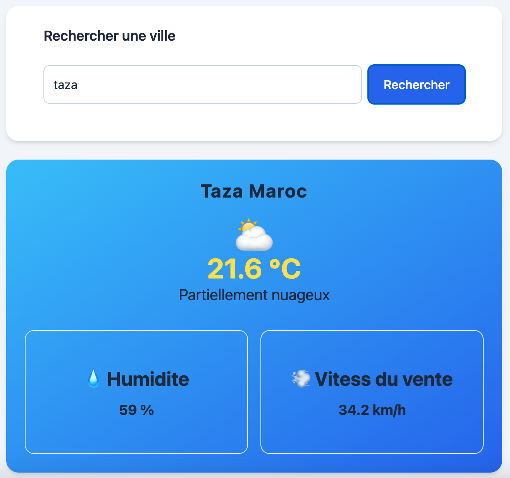
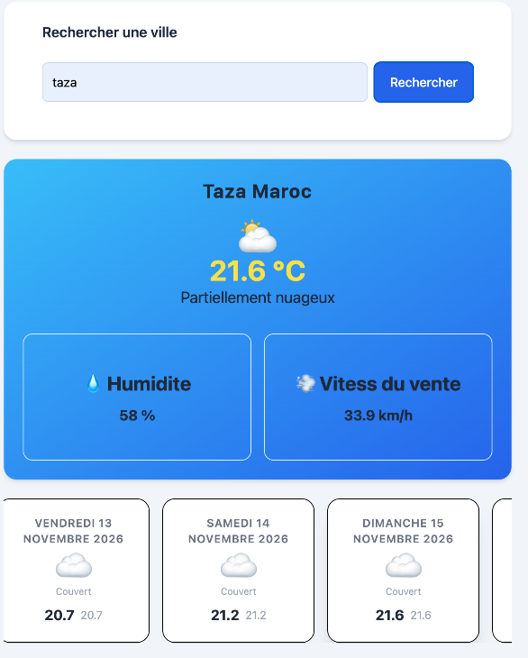

# Tests manuels — Weather App

## 1. Objectif

Ce document présente les tests manuels réalisés pour vérifier le bon fonctionnement des principales fonctionnalités de l'application Weather App.

## 2. Environnement de test

- Navigateur : Google Chrome
- Système : macOS
- API : Open-Meteo

## 3. Tests réalisés

### TEST-01 — Recherche d'une ville valide

**Étapes :**
1. Saisir `Taza` dans le champ de recherche.
2. Cliquer sur Rechercher.
3. Vérifier l'affichage des informations météorologiques.

**Résultat attendu :** Les informations météo de Taza s'affichent correctement.

**Résultat obtenu :** À compléter.

**Capture d'écran :**

---

### TEST-02 — Recherche d'une ville inexistante

**Étapes :**
1. Rechercher une ville valide comme Taza.
2. Effectuer une nouvelle recherche avec `fr`.
3. Vérifier le message d'erreur.

**Résultat attendu :** Le message « Ville introuvable ».

**Résultat obtenu :** À compléter.

**Capture d'écran :**

---

### TEST-03 — Affichage des prévisions

**Étapes :**
1. Rechercher une ville valide.
2. Attendre le chargement des données.
3. Vérifier les prévisions des cinq prochains jours.

**Résultat attendu :** Les cartes affichent les dates, les températures minimales et maximales ainsi que les icônes météo.

**Résultat obtenu :** À compléter.

**Capture d'écran :**

---

### TEST-04 — Gestion d'une erreur réseau

**Étapes :**
1. Désactiver la connexion Internet.
2. Effectuer une recherche.
3. Vérifier le message d'erreur et le bouton Réessayer.

**Résultat attendu :** Un message indiquant que le serveur est inaccessible s'affiche.

**Résultat obtenu :** À compléter.

**Capture d'écran :**

## 4. Conclusion

Les tests manuels permettent de vérifier les principales fonctionnalités de l'application : recherche de ville, gestion des villes introuvables, affichage des prévisions et gestion des erreurs réseau.